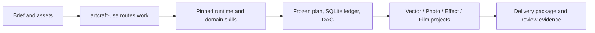

# ArtCraft

## Plugin marketplaces

This plugin belongs to **AIGC content creation**.

| Category | Marketplace | Purpose |
| --- | --- | --- |
| Full-stack development | [Full Stack Plugins](https://github.com/partme-ai/full-stack-plugins) | Architecture and UI design, code understanding, quality checks, code review, workflow governance, and server operations |
| AIGC content creation | [Full AIGC Plugins](https://github.com/partme-ai/full-aigc-plugins) | Image, video, audio, music, 3D, and multimodal content creation |

> Turn one brief into coordinated VectorCraft, PhotoCraft, EffectCraft and FilmCraft projects, with a frozen plan, a durable ledger and hash-bound delivery evidence.

[](.codex-plugin/plugin.json)
[](#skills)
[](LICENSE)

[English](README.md) | [简体中文](README.zh-CN.md) · [Install](#installation) · [Quick start](#quick-start) · [What you can build](#what-you-can-build) · [Skills](#skills) · [Troubleshooting](#troubleshooting)

## Positioning

ArtCraft is the orchestration layer for the four `*-craft` creative tools: it decomposes a mixed brief (brand graphics, posters, motion intros, captioned short films) into a dependency graph, installs the pinned runtimes and domain skills that graph needs, executes it with one writer per project, and keeps every native project, asset digest and receipt.

It is not a new editor. VectorCraft owns vector documents, PhotoCraft raster projects, EffectCraft compositions and FilmCraft timelines; ArtCraft owns routing, scheduling, revision scope, packaging and review evidence. Jianying has its own plugin and is out of scope here.

| 11 skills | 4 native domains | 1 execution channel | macOS arm64 |
|:---:|:---:|:---:|:---:|
| Routing and lifecycle | Vector, raster, motion, film | `artcraft-harness` scripts | Only verified platform |

## Status and version

`0.1.0-dev.142+codex.20261018` · development preview · `project-status.json` → `marketplaceEligible: false`, `supportedPluginHosts: []`.

## Installation

### Prerequisites

- macOS arm64. This is the only platform with first-use evidence; other platforms are not claimed.
- Python 3.11 or newer on `PATH`. The bootstrap script installs the pinned Node runtime itself, so no global Node is needed.
- No `sudo` and no `PATH` changes: installs stay in the user data directory (`~/.local/share/craft-runtimes` by default, override with `--runtime-home` or `CRAFT_RUNTIME_HOME`).
- Network access on first use, or pinned offline archives via `--node-archive`, `--bundle-dir` and `--native-archive-dir`.

### Development install

```bash
codex plugin marketplace add full-aigc-plugins/artcraft-plugin
codex plugin add artcraft@full-aigc-plugins-artcraft
```

`project-status.json` still records `marketplaceEligible: false` and an empty `supportedPluginHosts`, so treat this as a developer install of a `0.1.0-dev.*` candidate. There is no production marketplace entry for this package.

Manifests for Codex (`.codex-plugin/`), Claude Code (`.claude-plugin/`), ZCode (`.zcode-plugin/`) and Kimi (`kimi.plugin.json`) are present, but host discovery for this candidate is not accepted.

## Quick start

Point `HARNESS_DIR` at the skill directory the host actually loaded, then install the pinned runtime. Nothing is written to the system interpreter or to `PATH`.

```bash
: "${HARNESS_DIR:?Set to the directory holding the loaded artcraft-harness SKILL.md}"
python3 -I -B "$HARNESS_DIR/scripts/bootstrap.py" --runtime-only
```

The bootstrap returns JSON with `nodeExecutable` and `entryPoint`; `skills` is empty because no domain runtime was needed yet. Run the bundled four-domain example, then check the ledger and the reopened native projects:

```bash
python3 "$HARNESS_DIR/scripts/workflow.py" \
  "$SKILL_DIR/examples/brand-campaign.json" \
  --output /absolute/path/brand-project \
  --authorization brand-project-authorized \
  --asset voice=/absolute/path/voice.wav
```



The example requires a real `voice` WAV. If you have no audio, edit the plan and drop `audioRequired` instead of generating fake narration to satisfy the delivery check.

## What you can build

| Workflow | Built-in path | Verifiable output |
|:---|:---|:---|
| Mixed brand campaign | `artcraft-use` → harness workflow | Four native projects, collected media, previews and a delivery ledger |
| Replace a logo or asset | `artcraft-cli-revise` | Affected nodes rebuilt, unrelated nodes reused, previous delivery kept |
| Recover an interrupted run | `artcraft-cli-recover` | Original attempt adopted, no write replayed, stop evidence recorded |
| Package and relocate | `artcraft-cli-deliver` | Package verified after the move and after deleting the originals |
| Review a mixed delivery | `artcraft-cli-review` | Named observations bound to the current plugin and asset versions |
| Query native capability | `artcraft-cli` → domain command component | Command catalogue with the parameters of the installed build |

## Skills

| Skill | What it does |
|:---|:---|
| `artcraft-use` | Default entry: decompose the brief, choose tools, hand off dependencies, verify delivery |
| `artcraft-cli` | Query the public CLI surface and run explicit commands and diagnostics |
| `artcraft-cli-setup` | First install, digest checks, version checks and missing-runtime triage |
| `artcraft-cli-plan` | Plan tools, DAG and delivery constraints for brand, poster, intro and promo work |
| `artcraft-cli-execute` | Execute an existing plan with input-version and concurrent-write checks |
| `artcraft-cli-assets` | Register asset digests, provenance and sub-project dependencies |
| `artcraft-cli-revise` | Swap a logo or asset, revise native sub-projects, update downstream nodes |
| `artcraft-cli-recover` | Inspect task state, cancel the original task, recover after scheduler exit |
| `artcraft-cli-deliver` | Collect native projects, assets, plan and evidence; verify after relocation |
| `artcraft-cli-review` | Check technical evidence and visual, copy and audio consistency |
| `artcraft-harness` | The only execution implementation: bootstrap, workflow, review, revision, packaging |

## Configuration

| Variable / flag | Purpose |
|:---|:---|
| `HARNESS_DIR` | Absolute directory of the loaded `artcraft-harness` skill; all scripts run from `$HARNESS_DIR/scripts/` |
| `SKILL_DIR` | Directory of the loaded domain `SKILL.md`; used only for that skill's `examples/` and `references/` |
| `CRAFT_RUNTIME_HOME` / `--runtime-home` | Isolated runtime install root |
| `--authorization` | Reference to an existing task authorization scope, not a credential |
| `--output` | Absolute output directory; must be new, and an owned directory is never overwritten |

The package declares no MCP server of its own (`mcp.json` is absent). Everything runs through the harness scripts and the pinned native CLIs.

## Architecture and security

- Skill sources live in the separate `artcraft-skills` repository and arrive as locked snapshots; `skills.lock.json` pins the source commit and a per-skill SHA-256.
- Trusted configuration pins interpreter, script and native executable paths. Plan payloads cannot choose a shell, interpreter or executable.
- Python runs isolated without bytecode caches. Each project directory has one writer; plan revisions are frozen, and inputs are re-checked before use.
- Unknown outcomes are never replayed: an interrupted native write keeps its lease and requires reconciliation first.
- Evidence files are per-run JSON with hashes; `docs/README.md` indexes the architecture set and [OpenSpec](openspec/changes/establish-v1-plugin/proposal.md) holds the behavioural specification.

## Troubleshooting

| Symptom | Action |
|:---|:---|
| `unsupported_platform` | Only macOS arm64 is accepted; do not install another platform's artifact |
| Download or digest mismatch | The pinned artifact is missing or changed; restore network or pass a verified offline archive |
| `runtime_upgrade_busy` | Finish or trust-stop the task on the old runtime, then migrate; do not delete leases |
| Missing `voice` asset | Edit the plan and clear `audioRequired`; do not synthesize narration |
| Unknown save result | Read `failure.json`, the staged project and the stop evidence; do not re-run the same write |
| Image Factory or Jianying requested | Neither is integrated; Jianying stays in its own plugin |

## Upgrade

```bash
codex plugin marketplace upgrade full-aigc-plugins-artcraft
codex plugin add artcraft@full-aigc-plugins-artcraft
```

Runtime and skill identities are independent: reusing a version re-verifies its files, and a corrupted version fails loudly instead of being silently replaced or upgraded.

## Contributing and support

Read `AGENTS.md` before changing anything: behaviour changes go through OpenSpec first, and no task may be marked complete without real delivery evidence. Documentation and specification checks:

```bash
python3 scripts/validate_docs.py
openspec validate establish-v1-plugin --strict --no-interactive
```

These validate documents and specifications only. Report defects at <https://github.com/full-aigc-plugins/artcraft-plugin/issues>.

## License

Original repository content is [Apache-2.0](LICENSE). The bundled Node runtime and the four upstream creative CLIs keep their own licenses. Restricted upstream ArtCraft/Services code and brand assets are not copied; see [RELEASE-HISTORY.md](RELEASE-HISTORY.md) for version-bound history.
