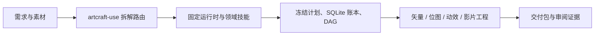

# ArtCraft

## 插件市场导航

本插件所属分类：**AIGC 内容创作**。

| 分类 | 插件市场入口 | 用途 |
| --- | --- | --- |
| 全栈开发 | [Full Stack Plugins](https://github.com/partme-ai/full-stack-plugins) | 架构与 UI 设计、代码理解、质量检查、代码审查、流程治理与服务器运维 |
| AIGC 内容创作 | [Full AIGC Plugins](https://github.com/partme-ai/full-aigc-plugins) | 图像、视频、音频、音乐、3D 与多模态内容创作 |

> 把一份需求变成相互协同的 VectorCraft、PhotoCraft、EffectCraft 与 FilmCraft 工程，并保留冻结计划、持久账本与哈希绑定的交付证据。

[](.codex-plugin/plugin.json)
[](#技能)
[](LICENSE)

[English](README.md) | [简体中文](README.zh-CN.md) · [安装](#安装) · [快速开始](#快速开始) · [可完成的工作](#可完成的工作) · [技能](#技能) · [故障排查](#故障排查)

## 项目定位

ArtCraft 是四个 `*-craft` 创作工具的编排层：把混合需求（品牌图形、海报、动态片头、带字幕短片）拆成依赖图，安装该图所需的固定运行时与领域技能，以“每个工程一个写入者”的方式执行，并完整保留原生工程、素材摘要与回执。

它不是新编辑器。矢量文档归 VectorCraft，位图工程归 PhotoCraft，合成归 EffectCraft，时间线归 FilmCraft；ArtCraft 负责路由、调度、修订范围、打包与审阅证据。剪映有独立插件，不在本插件范围内。

| 11 个技能 | 4 个原生领域 | 1 条执行通道 | macOS arm64 |
|:---:|:---:|:---:|:---:|
| 路由与生命周期 | 矢量、位图、动效、影片 | `artcraft-harness` 脚本 | 唯一已验证平台 |

## 状态与版本

`0.1.0-dev.142+codex.20261018` · 开发预览 · `project-status.json` → `marketplaceEligible: false`、`supportedPluginHosts: []`。

## 安装

### 前置条件

- macOS arm64。这是唯一具备首用证据的平台，其他平台不作承诺。
- `PATH` 上有 Python 3.11 或更新版本。固定 Node 运行时由 bootstrap 脚本自行安装，不需要全局 Node。
- 不需要 `sudo`，不修改 `PATH`：安装落在用户数据目录（默认 `~/.local/share/craft-runtimes`，可用 `--runtime-home` 或 `CRAFT_RUNTIME_HOME` 指定）。
- 首次使用需要网络，或通过 `--node-archive`、`--bundle-dir`、`--native-archive-dir` 提供固定的离线制品。

### 开发安装

```bash
codex plugin marketplace add full-aigc-plugins/artcraft-plugin
codex plugin add artcraft@full-aigc-plugins-artcraft
```

`project-status.json` 仍记录 `marketplaceEligible: false`，且 `supportedPluginHosts` 为空，因此请把它当作 `0.1.0-dev.*` 候选的开发安装；本包没有面向生产的市场条目。

仓库带有 Codex（`.codex-plugin/`）、Claude Code（`.claude-plugin/`）、ZCode（`.zcode-plugin/`）与 Kimi（`kimi.plugin.json`）清单，但本候选尚未通过宿主发现验收。

## 快速开始

把 `HARNESS_DIR` 指向宿主实际加载的技能目录，然后安装固定运行时。系统解释器和 `PATH` 都不会被修改。

```bash
: "${HARNESS_DIR:?请设为已加载 artcraft-harness 的 SKILL.md 所在目录}"
python3 -I -B "$HARNESS_DIR/scripts/bootstrap.py" --runtime-only
```

bootstrap 返回包含 `nodeExecutable` 与 `entryPoint` 的 JSON；此时 `skills` 为空，因为还没有安装领域运行时。接着运行内置的四领域示例，再核对账本与重新打开的原生工程：

```bash
python3 "$HARNESS_DIR/scripts/workflow.py" \
  "$SKILL_DIR/examples/brand-campaign.json" \
  --output /absolute/path/brand-project \
  --authorization brand-project-authorized \
  --asset voice=/absolute/path/voice.wav
```



示例需要真实的 `voice` WAV。没有音频时，应修改计划并去掉 `audioRequired`，而不是为了通过交付检查而生成假配音。

## 可完成的工作

| 工作流 | 内置路径 | 可验证输出 |
|:---|:---|:---|
| 混合品牌项目 | `artcraft-use` → harness workflow | 四个原生工程、收集素材、预览与交付账本 |
| 替换 Logo 或素材 | `artcraft-cli-revise` | 受影响节点重建、无关节点复用、旧交付保留 |
| 恢复中断的任务 | `artcraft-cli-recover` | 采用原执行、不重放写入、保留停止证据 |
| 打包并迁移 | `artcraft-cli-deliver` | 移动后、删除原件后仍可核验的交付包 |
| 审阅混合交付 | `artcraft-cli-review` | 绑定当前插件与素材版本的具名观察记录 |
| 查询原生能力 | `artcraft-cli` → 领域命令组件 | 带已安装版本真实参数的命令目录 |

## 技能

| 技能 | 作用 |
|:---|:---|
| `artcraft-use` | 默认入口：拆解需求、选择工具、依赖交接与交付核验 |
| `artcraft-cli` | 查询公开 CLI 能力，执行明确命令与诊断 |
| `artcraft-cli-setup` | 首次安装、摘要校验、版本检查与缺失运行时排障 |
| `artcraft-cli-plan` | 规划品牌、海报、片头与宣传片的工具、DAG 与交付约束 |
| `artcraft-cli-execute` | 执行已有计划，核对输入版本与并发写入 |
| `artcraft-cli-assets` | 登记素材摘要、来源与子工程依赖 |
| `artcraft-cli-revise` | 替换 Logo 或资产，修改原生子工程并更新下游节点 |
| `artcraft-cli-recover` | 检查任务状态、取消原任务、调度器退出后恢复 |
| `artcraft-cli-deliver` | 收集原生工程、素材、计划与证据，迁移后核验 |
| `artcraft-cli-review` | 检查技术证据与视觉、文案、音频一致性 |
| `artcraft-harness` | 唯一的执行实现：bootstrap、workflow、审阅、修订、打包 |

## 配置

| 变量 / 参数 | 用途 |
|:---|:---|
| `HARNESS_DIR` | 已加载 `artcraft-harness` 技能的绝对目录；所有脚本从 `$HARNESS_DIR/scripts/` 执行 |
| `SKILL_DIR` | 已加载领域 `SKILL.md` 所在目录；仅用于该技能的 `examples/` 与 `references/` |
| `CRAFT_RUNTIME_HOME` / `--runtime-home` | 隔离的运行时安装根目录 |
| `--authorization` | 既有任务授权范围的引用，不是凭据 |
| `--output` | 绝对输出目录；必须是新目录，已归属的目录不会被覆盖 |

本包自身不声明 MCP server（没有 `mcp.json`）。全部流程通过 harness 脚本与固定的原生 CLI 执行。

## 架构与安全

- 技能源码位于独立的 `artcraft-skills` 仓库，以锁定快照形式进入插件；`skills.lock.json` 固定源码提交与每个技能的 SHA-256。
- 受信配置固定解释器、脚本与原生可执行文件路径。计划载荷无法指定 shell、解释器或可执行文件。
- Python 以隔离模式运行且不写字节码缓存。每个工程目录只有一个写入者；计划修订被冻结，输入在使用前重新核对。
- 未知结果一律不重放：中断的原生写入保留租约，必须先完成核对。
- 证据是带哈希的单次运行 JSON；`docs/README.md` 是架构文档索引，行为规范见 [OpenSpec](openspec/changes/establish-v1-plugin/proposal.md)。

## 故障排查

| 现象 | 处理方式 |
|:---|:---|
| 返回 `unsupported_platform` | 仅接受 macOS arm64；不要安装其他平台制品 |
| 下载或摘要不匹配 | 固定制品缺失或被改动；恢复网络，或提供已核验的离线制品 |
| 返回 `runtime_upgrade_busy` | 先在旧运行时上完成或可信停止任务，再迁移；不要删除租约 |
| 缺少 `voice` 素材 | 修改计划并去掉 `audioRequired`；不要合成配音 |
| 保存结果未知 | 读取 `failure.json`、暂存工程与停止证据；不要重跑同一写入 |
| 需要 Image Factory 或剪映 | 两者都未接入；剪映请使用其独立插件 |

## 升级

```bash
codex plugin marketplace upgrade full-aigc-plugins-artcraft
codex plugin add artcraft@full-aigc-plugins-artcraft
```

运行时身份与技能身份相互独立：复用某个版本会重新核验其文件，损坏的版本会明确失败，而不是被静默替换或升级。

## 贡献与支持

改动前先读 `AGENTS.md`：行为变更必须先走 OpenSpec，且没有真实交付证据不得勾选任务。文档与规范校验：

```bash
python3 scripts/validate_docs.py
openspec validate establish-v1-plugin --strict --no-interactive
```

这两条只校验文档与规范。缺陷请提交到 <https://github.com/full-aigc-plugins/artcraft-plugin/issues>。

## 许可证

本仓库原创内容采用 [Apache-2.0](LICENSE)。随包安装的 Node 运行时与四个上游创作 CLI 各自保留其许可证。受限的上游 ArtCraft/Services 代码与品牌素材未被复制；按版本绑定的历史见 [RELEASE-HISTORY.md](RELEASE-HISTORY.md)。
